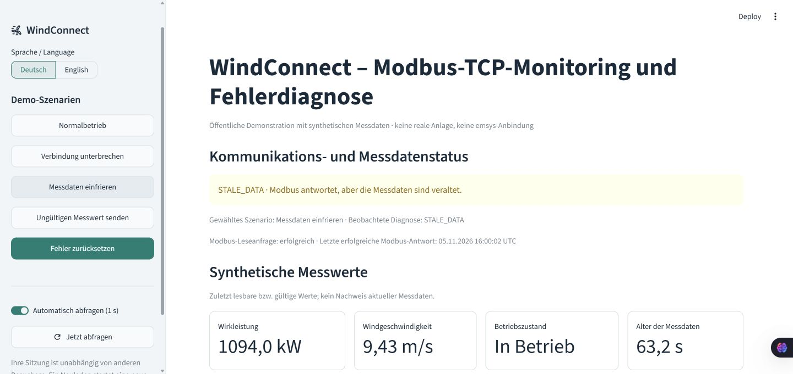

# WindConnect – Modbus TCP Monitoring and Fault Diagnostics

**Eigenständiges, lokal getestetes Simulationsprojekt** · Python · Modbus TCP · Streamlit

WindConnect simuliert den Datenaustausch einer Windenergieanlage mit einer
Monitoring-Gegenstelle eines virtuellen Kraftwerks. Das deutsche Dashboard zeigt
Messwerte, Kommunikationsstatus, Datenaktualität und nachvollziehbare Support-Hinweise.

**Demonstrationsprojekt – keine Verbindung zu realen Anlagen oder emsys-Systemen.**
Dieses Projekt ist kein emsys-Produkt, keine Kooperation und keine industrielle
Steuerungssoftware. Alle Messwerte sind synthetisch. Es gibt keine Anlagensteuerbefehle.



## Repository und Portfolio

[GitHub-Repository](https://github.com/abufanasa-dotcom/windconnect) · [Projektvorstellung (DE)](https://abufanasa-dotcom.github.io/projects/windconnect.html) · [Project overview (EN)](https://abufanasa-dotcom.github.io/en/projects/windconnect.html)

English overview: independent local wind-turbine simulation with real Modbus TCP, fault diagnosis, a German Streamlit dashboard, and 66 automated tests. The application runs locally; screenshots and setup instructions are included. No connection to real turbines or emsys systems.

## Zwei Dashboard-Varianten

- `dashboard/app.py`: lokale deutsche Support-Ansicht mit fortlaufendem Backend und Dateien.
- `public_dashboard/app.py`: deutsch-englische öffentliche Demo mit getrennten Sitzungen. Pro Abfrage erfolgt ein tatsächlicher, kurzlebiger Modbus-TCP-Austausch ausschließlich auf Loopback des App-Servers; danach wird der Listener geschlossen. Kein gemeinsamer Steuerordner und kein globaler Hintergrundserver.

Die öffentliche Variante lässt sich auch lokal prüfen:

```powershell
.\.venv\Scripts\python.exe -m streamlit run public_dashboard/app.py --server.address 127.0.0.1 --server.port 8503
```

Auf Streamlit Community Cloud: Python 3.13, Branch `main`, Entrypoint `public_dashboard/app.py`, Abhängigkeiten aus `requirements.txt`. Die öffentliche HTTP-Oberfläche verwendet ihre eigene Konfiguration; der Modbus-Transport bleibt immer an 127.0.0.1 gebunden.

[Begriffstabelle Deutsch/Englisch](docs/terminology_de_en.md). Der VPP-Bezug ist ein Anwendungskontext, keine reale VPP-Integration.

## Was funktioniert?

- Deterministischer Simulator einer 3-MW-Anlage mit einfacher Leistungskennlinie.
- Echter Modbus-TCP-Server und separater Polling-Client auf `127.0.0.1:15020`.
- Versionierte, getestete Holding-Registermap mit Messzeitstempel und Sequenzzähler.
- Priorisierte Zustände `HEALTHY`, `CONNECTION_LOST`, `INVALID_MEASUREMENT`, `STALE_DATA`.
- Reproduzierbare Fehler: Server stoppen, Probe einfrieren, Windwert verfälschen.
- Übergangsprotokoll mit `RECOVERED`, letztem Kontakt und letzten gültigen Messwerten.
- Deutsches Dashboard mit Demo-Steuerung, Verlauf und exportierbarem Diagnosebericht.
- Atomare JSON-Snapshots, rotierende JSONL-/Backend-Logs und Schutz vor zwei Schreibern.
- Automatisierte Unit-, echte TCP-Integrations- und Streamlit-Interaktionstests.

## Voraussetzungen und Installation unter Windows

Getestet: Windows 11, Build 26300, **CPython 3.13.15 (64 Bit)**.
Für reproduzierbare Neuinstallationen Python 3.13 verwenden. Python 3.14 wurde auf
dem Rechner gefunden, aber nicht für dieses Projekt getestet. Die Python-Versionen
3.12–3.14 sind im Paket zugelassen; die eingefrorenen Binärpakete wurden nur mit 3.13 geprüft.

Projekt in einen eigenen Ordner kopieren/entpacken, beispielsweise
`C:\Projects\windconnect`. Die mitgelieferte `.venv` ist rechnergebunden und gehört
nicht in Git oder ein Austauscharchiv. Nach einem Umzug neu erstellen.

```powershell
cd C:\Projects\windconnect
py -3.13 -m venv .venv
.\.venv\Scripts\python.exe -m pip install --upgrade pip
.\.venv\Scripts\python.exe -m pip install -c requirements-lock.txt -e ".[dev]"
.\.venv\Scripts\python.exe -m pytest -q
.\.venv\Scripts\ruff.exe check .
.\.venv\Scripts\ruff.exe format --check .
```

`requirements-lock.txt` fixiert auch die transitiven Laufzeit-/Testabhängigkeiten.
Für eine bewusst neue Auflösung reicht `pip install -e ".[dev]"`; die direkten
Abhängigkeiten sind weiterhin exakt in `pyproject.toml` fixiert.

Falls `py`/`python` nur einen defekten Windows-App-Alias aufrufen, einen tatsächlich
installierten Interpreter verwenden, z. B.:

```powershell
& 'C:\Pfad\zu\Python313\python.exe' -m venv .venv
```

Alternativ mit bereits installiertem `uv`:

```powershell
uv venv --python 3.13 .venv
uv pip install --python .venv/Scripts/python.exe -c requirements-lock.txt -e ".[dev]"
```

`uv` kann einen passenden Interpreter herunterladen. Das verändert keine globale
Python-Installation. Die Installation benötigt Internet; der Betrieb danach nicht.
Aktivierung ist optional. Bei gesperrtem `Activate.ps1` die oben gezeigten direkten
Interpreteraufrufe verwenden, ohne die PowerShell-Sicherheitsrichtlinie zu ändern.

## Starten: zwei PowerShell-Terminals

Beide Terminals im Projektverzeichnis öffnen.

**Terminal 1 – Backend:**

```powershell
.\.venv\Scripts\python.exe -m windconnect.runner
```

**Terminal 2 – Dashboard:**

```powershell
.\.venv\Scripts\python.exe -m streamlit run dashboard/app.py
```

Im Browser [http://127.0.0.1:8501](http://127.0.0.1:8501) öffnen.
Jeweils `Strg+C` beendet den Prozess. Keine Hintergrundserver entstehen durch UI-Reruns.
Die Streamlit-Konfiguration bindet ausschließlich Loopback und deaktiviert Nutzungsstatistik.
Schriften werden lokal mit Streamlit ausgeliefert; keine externen Schrift-CDNs.

Mit aktivierter venv sind die Befehle aus dem Projektbrief ebenfalls gültig:

```powershell
.\.venv\Scripts\Activate.ps1
python -m windconnect.runner
# Im zweiten aktivierten Terminal:
python -m streamlit run dashboard/app.py
```

Optional stehen `Start-Backend.ps1` und `Start-Dashboard.ps1` bereit, wenn lokale
Skriptausführung erlaubt ist. Die direkten Python-Befehle funktionieren ohne diese Skripte.

## Demo in zwei Minuten

1. **Normalbetrieb:** `Online · HEALTHY`, Leistung, Wind und fortlaufende Sequenz zeigen.
2. **Daten einfrieren:** anklicken, etwa 6–7 Sekunden warten. `STALE_DATA` erscheint,
   obwohl der letzte erfolgreiche Modbus-Kontakt weiter aktualisiert wird.
3. **Erklären:** Ein offener TCP-Kanal beweist nicht, dass neue Messwerte geliefert werden.
4. **Fehler zurücksetzen:** frische Probe, `RECOVERED` und wieder `HEALTHY` zeigen.
5. Optional **Verbindung unterbrechen** und **Ungültigen Messwert senden** ausprobieren;
   nach jedem Szenario zurücksetzen. Der letzte gültige Messwert bleibt sichtbar und
   wird bei einer Störung ausdrücklich als historisch gekennzeichnet.

Die UI schreibt nur einen Demo-Befehl. Angeforderter Modus, Backend-Szenario und
beobachtete Diagnose werden getrennt angezeigt. Beim Neustart beginnt das Backend
mit Normalbetrieb; alte Steuerdateien werden nicht als neue Befehle wiederholt.

Dieselben Szenarien lassen sich per CLI anfordern:

```powershell
.\.venv\Scripts\python.exe -m windconnect.cli freeze
.\.venv\Scripts\python.exe -m windconnect.cli disconnect
.\.venv\Scripts\python.exe -m windconnect.cli invalid
.\.venv\Scripts\python.exe -m windconnect.cli reset
.\.venv\Scripts\python.exe -m windconnect.cli status
```

## Konfiguration

```powershell
.\.venv\Scripts\python.exe -m windconnect.runner --help
.\.venv\Scripts\python.exe -m windconnect.runner --port 15021 --interval 1 --stale-after 5 --timeout 0.5 --retries 1 --seed 42
# Endlicher Smoke-Test, beendet sich selbst:
.\.venv\Scripts\python.exe -m windconnect.runner --duration 5
```

Default: Polling 1 s, Stale-Schwelle 5 s, maximal 2 Leseversuche (`retries + 1`),
jeweils maximal 0,5 s einschließlich Verbindungsaufbau. Bei langsamen Antworten dauert
ein Poll länger als das Sollintervall; es werden keine überlappenden Polls gestartet.
PyModbus wartet beim Connect intern 100 ms, daher für reale Tests Timeout >= 0,3 s wählen.
Stale-Schwelle mindestens zwei Pollintervalle, für die normale Demo mindestens 5 s.

Eigene Datendateien sind optional. Backend, CLI und UI müssen denselben Ordner verwenden:

```powershell
# Terminal 1
.\.venv\Scripts\python.exe -m windconnect.runner --data-dir .\data\demo2 --port 15021
# Terminal 2
$env:WINDCONNECT_DATA_DIR = "$PWD\data\demo2"
.\.venv\Scripts\python.exe -m streamlit run dashboard/app.py --server.port 8502
# CLI
.\.venv\Scripts\python.exe -m windconnect.cli reset --data-dir .\data\demo2
```

## Fehlersuche

| Symptom | Prüfung |
|---|---|
| Noch keine Daten | Backend starten, identische Datenpfade prüfen |
| Backend nicht aktiv | Heartbeat fehlt oder Prozess wurde beendet; historische Diagnose beachten |
| Port belegt | Anderen `--port` wählen oder den eigenen vorherigen Backend-Prozess beenden |
| CONNECTION_LOST | Demo-Szenario, Loopback-Endpunkt und `data/backend.log` prüfen |
| STALE_DATA | Sequenz und Messzeit vergleichen, eingefrorene Probe zurücksetzen |
| INVALID_MEASUREMENT | Wertebereich, Skalierung und Registerversion prüfen |
| Steuerdatei ungültig | CLI `reset` schreibt einen neuen vollständigen Befehl |
| Zwei Backends im selben Datenordner | Zweiten Prozess beenden oder eigenen Datenordner verwenden |
| Installation: WinError 206 | Kurzen Projekt-/Temppfad wählen; Build nutzt Hatchling statt tief verschachtelter Setuptools-Testdaten |
| Native DLL wird blockiert | Dokumentierte Versionen in frischer venv installieren; keine Sicherheitsrichtlinien abschalten |

Nur in eingeschränkten Ausführungsumgebungen, wenn deren Standard-Tempordner nicht
beschreibbar ist, vor Installation/Tests einen beschreibbaren Tempordner setzen:

```powershell
New-Item -ItemType Directory -Force .\data\tmp | Out-Null
$env:TEMP = "$PWD\data\tmp"
$env:TMP = $env:TEMP
```

## Architektur, Tests und Portfolio

- [Architektur und Designentscheidungen](docs/architecture.md)
- [Registermap, Einheiten und Endianness](docs/register_map.md)
- [Testbericht mit tatsächlich ausgeführten Prüfungen](docs/test_report.md)
- [Interview-Pitch und korrekte CV-Formulierungen](docs/interview_pitch_de.md)
- [Dateibaum](docs/file_tree.txt)

Zusätzliche reproduzierbare Prozess-Smoke-Tests (etwa 10 s je Skript):

```powershell
.\.venv\Scripts\python.exe scripts/verify_demo.py
.\.venv\Scripts\python.exe scripts/verify_dashboard_start.py
```

Das erste Skript verwendet einen isolierten Datenordner und einen freien lokalen Port,
prüft alle Fehler und Wiederherstellungen und wartet auf das reguläre Backend-Ende.
Das zweite prüft HTTP-Start und beendet seinen eigenen Wegwerf-UI-Prozess über einen
internen 10-s-Watchdog. Es prüft nicht die Browserdarstellung; dafür gibt es die
Streamlit-AppTests und die dokumentierte manuelle Browser-Demo.

Screenshots: Normalbetrieb herstellen, Browser auf ca. 1440 px Breite, Zoom 100 %.
Den Projekthinweis immer im Bild lassen. Für `STALE_DATA` einfrieren und auf die
beobachtete Diagnose warten. Mit dem Windows Snipping Tool nur das Dashboard aufnehmen,
unter `screenshots/` speichern; keine anderen Browser-Tabs oder persönlichen Daten.
Vorhandene Aufnahmen zeigen ausschließlich synthetische Demo-Daten.

## Grenzen

Das Modell ersetzt keine physikalische Turbinensimulation. Keine Prognosen, ML,
Datenbank, Authentifizierung oder produktive VPN-/VPP-Anbindung. Modbus TCP
ist hier unverschlüsselt und nur lokal; keine industrielle Zertifizierung, Redundanz
oder Echtzeitgarantie. Ein externer Modbus-Client kann die simulierten Werte lesen,
aber keine Telemetrie schreiben. Der lokale Steuerordner ist für einen vertrauenswürdigen
Benutzer gedacht, nicht als Sicherheitsgrenze zwischen Benutzern.

Verlauf: maximal 120 gesunde Proben im aktuellen Lauf. Ereignisse: aktuelles Log und
eine Vorgängerdatei, Rotation ab ca. 1 MB; Anzeige der letzten 100 Einträge. Kein
Langzeitarchiv. Backend-Neustart startet den Diagnoseautomaten neu und vergibt eine neue
Lauf-ID. Uhrzeitsprünge können die UTC-Altersprüfung beeinflussen; zusätzlich überwacht
eine monotone Uhr die beiden Fortschrittssignale. Tabellarische Zeiten sind UTC;
die Diagrammachse verwendet die Browser-Zeitzone. Offline-Betrieb wurde funktional
ohne externe Datenquellen ausgelegt, jedoch nicht bei physisch deaktivierter Netzwerkkarte getestet.
