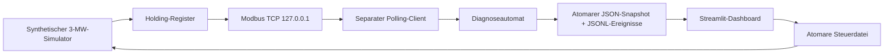

# Architektur und technische Entscheidungen

## Datenfluss

Simulator, Server, Client und Diagnose laufen in einem Prozess mit einem asyncio-Loop.
Server und Client verwenden tatsächlich einen TCP-Socket, keinen direkten Funktionsersatz.
Die Streamlit-Oberfläche läuft als separater Prozess. Ein UI-Rerun startet keine Dienste.
Es gibt absichtlich keine HTTP-Control-API und keine Verbindung zu externen Anlagen.

## Module

| Modul | Verantwortung |
|---|---|
| models / simulator | Typisierte Messprobe, Validierung, deterministische Wind-/Leistungswerte |
| registers | Versionierte Binärstruktur, Skalierung und strenge Dekodierung |
| modbus_server | Loopback-Bindung, schreibgeschützte Register, Start/Stopp |
| modbus_client | Zeitlich begrenzte TCP-/Modbus-Leseversuche |
| diagnostics | Priorität, Aktualität, Zustandswechsel und Wiederherstellung |
| storage | Atomare Dateien, begrenzte Logs, Prozesssperre |
| control / cli | Whitelist-Szenarien und lokal nachvollziehbare Befehle |
| runner | Orchestrierung und Logging, garantiertes Schließen im finally-Block |
| presentation / dashboard | Verfügbarkeit des Backends und deutsche Support-Ansicht |

## Diagnose

Priorität: Verbindungs-/Modbus-Anfragefehler → ungültige Messwerte → veraltete Daten → gesund.
0 kW sind gültig; STOPPED mit positiver Leistung ist inkonsistent.
Die Probe enthält UTC-Zeitstempel und uint32-Sequenz. Beide müssen fortschreiten;
bleibt eines mindestens 5 s stehen, wird STALE_DATA gemeldet. Die monotone Laufzeituhr
misst Fortschritt unabhängig von der Systemuhr. Zusätzlich wird das UTC-Probenalter
geprüft. Zeitstempel über 2 s in der Zukunft sind ungültig. Der uint32-Zähler darf
überlaufen; ein Rücksprung wird nicht als Vorwärtsfortschritt gewertet.

Gleiche Diagnosen erzeugen keine wiederholten Ereignisse. Eine frische, gültige
Probe nach einer Störung erzeugt RECOVERED und HEALTHY. Eine wieder erreichbare
Verbindung mit der alten Probe bleibt STALE_DATA bis zu einer neuen Probe.
Der letzte erfolgreiche Kontakt umfasst auch erfolgreiche Reads mit ungültigen Daten;
die letzte gesunde Probe wird separat aufbewahrt.

## Fehlermechanismen

- disconnect: Listener und bestehende Serververbindungen werden geschlossen;
  der echte Polling-Client erhält keine erfolgreiche Antwort mehr.
- freeze: kompletter Messblock bleibt unverändert; Server antwortet weiter.
- invalid: Windregister 10 wird auf 65535 gesetzt (655,35 m/s).
- normal/reset: gültige neue synthetische Probe; Listener bei Bedarf neu starten.

Kommandos haben UUID und Modus; Verarbeitung ist spätestens beim nächsten Poll vorgesehen.
Ein bestätigtes Kommando ist kein Diagnosenachweis. Parallel gesendete Befehle folgen
Last-write-wins; dies ist eine Einbenutzer-Demo. Alte Befehle werden beim Start nicht wiederholt.

## Windows und Lifecycle

PyModbus 3.11.4 addiert beim DeviceContext intern 1 zur Adresse. Der Datastore startet
deshalb bei 1, während der Client Protokolladresse 0 liest. Seine Standardoption
SO_REUSEADDR wurde über die Connection-Factory deaktiviert, da Windows sonst konkurrierende
Listener erlaubt. Diese versionsabhängige Anpassung wird durch Port-Kollision und
Same-Port-Restart getestet. Bei PyModbus-Upgrades diese Tests zwingend erneut ausführen.

Snapshots: temporäre Datei im selben Verzeichnis, flush/fsync, os.replace; begrenzte
Retries bei Windows-Dateifreigabekonflikten. Eine OS-Dateisperre verhindert zwei
Backends im selben Datenverzeichnis und wird beim Prozessende automatisch freigegeben.
Bei Strg+C läuft der finally-Block, schließt den Listener und markiert den Snapshot
als beendet. Nach hartem Prozessabbruch verhindert der UI-Heartbeat ein altes Online-Signal.

Der Heartbeat-Grenzwert ist max(5 s, 3 × Intervall + Versuche × Timeout).
Polls sind sequenziell, maximal retries+1 Versuche, ohne unbeschränkte Wiederholung.
Alle automatischen Integrationsszenarien haben explizite Gesamttimeouts und finally-Cleanup.

## Build und Abhängigkeiten

Python 3.13.15, PyModbus 3.11.4, Streamlit 1.66.1. Die Daten-/UI-Abhängigkeiten
NumPy 2.2.6, pandas 2.2.3 und PyArrow 20.0.0 sind auf dieser Windows-Umgebung geprüft.
Sie werden für Streamlit-Charts und Tabellen benötigt, nicht für die Kernsimulation.
Hatchling 1.27.0 vermeidet die aufgetretenen langen Setuptools-Buildpfade unter Windows.
`requirements-lock.txt` fixiert die aufgelöste Umgebung. Kein globaler Python-Umbau.
